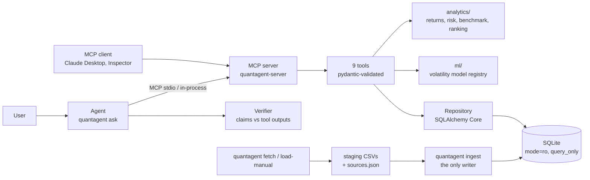

# QuantAgent

QuantAgent answers questions about Indian equity mutual funds from real public data. It downloads the
AMFI scheme list and full daily NAV histories (via mfapi.in) for every open-ended equity Direct-Growth
scheme with at least five years of history, AMFI expense-ratio disclosures, and optionally Nifty Total
Return Index and 91-day T-bill files. It validates them into a SQLite database and serves nine analytics
tools over the Model Context Protocol (MCP). An LLM agent answers through those tools, and every number
in its answer is checked against the tool output it cites. A walk-forward-evaluated model forecasts
21-day volatility. Read-only MCP server + agent + volatility model over real AMFI data.

[](https://github.com/Likhith1807/bluestock-quantagent/actions/workflows/ci.yml)


The coverage badge is regenerated by CI on every push to `master`; CI fails below 90%. The CI and
coverage badges are served by GitHub from this repository, so they show only to viewers who can see the
repository.

Built on work from my Bluestock internship. This repository contains no Bluestock data; the test
suite uses a synthetic fixture generated in `tests/fixtures/`.

## Architecture



Data flows right to left: `fetch` and `load-manual` write staging CSVs with their provenance, `ingest`
validates them into SQLite (the only writer), and the MCP server reads that file read-only. The agent
calls the server's tools and the verifier checks every number in its answer against those tool outputs.

## Quickstart

From a fresh clone to a first answer, in a clean Docker container:

```bash
git clone https://github.com/Likhith1807/bluestock-quantagent.git && cd bluestock-quantagent
docker build -t quantagent .
docker run --rm -v qa:/app/var quantagent setup --ter-months 1    # downloads AMFI data, ingests
docker run --rm -v qa:/app/var quantagent tool rank_funds '{"metric": "sharpe", "period": "3y", "category": "Large Cap", "top_n": 3}'
docker run --rm -v qa:/app/var -e ANTHROPIC_API_KEY quantagent ask "Which large-cap fund had the best 3-year Sharpe ratio?"
```

The fourth command answers without an LLM (one tool call, JSON out). The fifth needs an Anthropic API
key. Without Docker: `pip install -e ".[dev]"`, then the same commands without the `docker run` prefix.
`quantagent train` adds the volatility model (about 40 minutes on 308 schemes, mostly GARCH fits).
Checked on 2026-10-20 with an empty Docker volume: `setup --ter-months 1` took 5 min 15 s (308 schemes, 876,930 NAVs) and the `rank_funds` call returned the ranking shown in the worked example below. A fresh `git clone` builds the Docker `test` target (ruff, the test suite, evaluation) without errors.

Nifty TRI and T-bill data must be downloaded by hand, because both sites block scripts:
* Nifty TRI: niftyindices.com, Reports > Historical Data > Total Returns Index, one year per request.
  Any number of CSVs with `Index Name`, `Date` and a total-return column go in `data/external/niftyindices/`.
* 91-day T-bill: RBI DBIE, Statistics > Financial Market > Government Securities Market > Auctions of
  91-Day Government of India Treasury Bills (export as HTML or Excel; the TXT export drops decimals).
  Save `date` and the implicit yield at cut-off price (percent) as `data/external/tbill_91d.csv`.

Then run `quantagent load-manual && quantagent ingest`. The results in this README use files
downloaded on 2026-10-21: seven Nifty TRI series from 2012-01-02 to 2026-10-19, and 1,755 weekly
auctions from 1993-01-08 to 2026-10-14. Neither file is committed (the publishers' terms do not allow
redistribution).

## Tools

Full schemas and real outputs: [docs/TOOLS.md](docs/TOOLS.md). Every result carries `meta`
(period, n_obs, data_as_of, data_version, calc_version, data_nature, data_source, data_retrieved_at,
assumptions), `warnings` and `excluded`. Errors are `{code, message, details}`.

| Tool | Purpose | Key inputs | Key output fields |
|---|---|---|---|
| `search_funds` | Find schemes by name, code, category, fund house | `query`, `category`, `fund_house`, `plan_type` | `items[].scheme_code`, `latest_expense_ratio`, `nav_coverage`, `total_matches` |
| `get_nav_history` | NAV series with gap detection | `scheme_code`, dates, `frequency` | `points[]`, `gaps[]`, `missing_trading_days` |
| `get_risk_metrics` | One fund's risk over a window | `scheme_code`, `period` or dates | `volatility`, `sharpe`, `sortino`, `max_drawdown{}`, `alpha`, `beta`, `n_obs` |
| `compare_funds` | 2-10 funds on the same dates | `scheme_codes`, `period` | `funds[].cagr/volatility/sharpe`, `correlation`, `fair_comparison` |
| `rank_funds` | Screen a category by a metric or weighted score | `metric` or `weights`, `period`, `category` | `ranked[].metrics`, `eligible_count`, `excluded[]` |
| `get_benchmark_comparison` | Fund vs its Nifty TRI | `scheme_code`, `period` | `tracking_error`, `information_ratio`, `excess_cagr`, capture ratios |
| `check_data_quality` | Gaps, stale runs, jumps, metadata | `scheme_codes` | `schemes[].status`, `issues[]` |
| `get_data_provenance` | Sources, download dates, licences, biases | `scheme_code` (optional) | `sources[]`, `assumptions`, `known_biases` |
| `predict_volatility` | 21-day volatility forecast | `scheme_code`, `as_of` | `forecast_vol`, `baselines{}`, `model{}` (out-of-sample scores) |

## Worked example

Question: *"Which three large-cap funds had the best 3-year Sharpe ratio, and did the leader beat its
benchmark?"* (data as of 2026-10-19, data version 3, with Nifty TRI and 91-day T-bill series loaded).

Tool calls, run with `quantagent tool` (an agent makes the same calls; `quantagent ask` prints its own
call log):

```json
rank_funds {"metric": "sharpe", "period": "3y", "category": "Large Cap", "top_n": 3}
```
```json
{"period": "3y", "ranked_by": "sharpe", "universe_size": 27, "eligible_count": 27,
 "ranked": [
  {"rank": 1, "scheme_code": "118870", "scheme_name": "Taurus Large Cap Fund - Direct Plan - Growth",
   "metrics": {"sharpe": 0.5532, "cagr": 0.1304, "volatility": 0.1396, "max_drawdown": -0.1762}, "expense_ratio_pct": 2.51},
  {"rank": 2, "scheme_code": "120392", "scheme_name": "Invesco India Large Cap Fund - Direct Plan - Growth",
   "metrics": {"sharpe": 0.5205, "cagr": 0.1281, "volatility": 0.1448, "max_drawdown": -0.1821}, "expense_ratio_pct": 0.9},
  {"rank": 3, "scheme_code": "118479", "scheme_name": "BANDHAN LARGE CAP FUND - Direct Plan - Growth",
   "metrics": {"sharpe": 0.4782, "cagr": 0.1195, "volatility": 0.1355, "max_drawdown": -0.1795}, "expense_ratio_pct": 1.06}],
 "warnings": ["Survivorship bias: closed and merged schemes are absent from the source data, ..."]}
```
```json
get_benchmark_comparison {"scheme_code": "118870", "period": "3y"}
```
```json
{"benchmark": {"index_name": "NIFTY100_TRI", "index_type": "TRI"},
 "fund": {"cagr": 0.1304, "volatility": 0.1399, "max_drawdown": -0.1762},
 "benchmark_stats": {"cagr": 0.0809, "volatility": 0.1393, "max_drawdown": -0.1722},
 "excess_cagr": 0.0495, "tracking_error": 0.0422, "information_ratio": 1.1008,
 "beta": 0.9584, "alpha": 0.0477, "r_squared": 0.9108,
 "up_capture": 1.1776, "down_capture": 0.8976, "up_months": 24, "down_months": 12, "n_shared": 732,
 "meta": {"period": {"start": "2023-10-19", "end": "2026-10-19"}, "data_nature": "real",
          "assumptions": ["Trading calendar derived from NAV publication dates (no NSE holiday list supplied)."]}}
```

`get_risk_metrics` on the same fund returns the same beta and alpha (one regression path; a real-data
test checks both tools against independent pandas), Sortino 0.757, and the drawdown dates below. Its
`risk_free_source` is the RBI 91-day T-bill auction series, so no risk-free assumption is made.

Answer, using only these outputs (values rounded; JSON above is shortened to 4 decimals):

> Over the three years to 2026-10-19, the highest Sharpe ratios among the 27 large-cap Direct-Growth
> funds were Taurus Large Cap (0.55, calculated), Invesco India Large Cap (0.52, calculated) and
> Bandhan Large Cap (0.48, calculated), using 91-day T-bill yields as the risk-free rate. Taurus
> returned 13.0% a year against 8.1% for the Nifty 100 TRI (calculated), with a tracking error of 4.2%
> and an information ratio of 1.10 (calculated). Its beta was 0.96 and its annualised alpha 4.8%
> (calculated). It captured 118% of the index's up months and 90% of its down months (calculated). Its
> worst drawdown was -17.6% (calculated), from 2024-09-27 to 2025-02-28, recovered by 2026-07-31.
> Its 2.51% expense ratio is the highest of the three. Survivorship bias applies. Not investment advice.

A note on that expense ratio: 2.51% is unusually high for a Direct plan, so it was checked against
AMFI's TER disclosure for October 2026. AMFI reports Taurus Large Cap's Direct-plan total TER as 2.51%
(1.88% base expense + 0.10% brokerage + 0.53% statutory levies) and its Regular-plan TER as 2.73%, so
this is the Direct figure, not a Regular-plan value mapped to the wrong plan. It is the highest of the
35 large-cap Direct plans in that disclosure (median 1.08%).

## Methodology

Summary; the full definitions are in [METHODOLOGY.md](src/quantagent/resources/METHODOLOGY.md), also served
as the MCP resource `quantagent://methodology`.

* Daily simple returns, 252-day annualisation. CAGR uses calendar days / 365.25. Sharpe and Sortino use
  daily excess returns over the risk-free rate.
* **Growth options only:** IDCW NAVs fall on every payout, so they are not total-return series.
* **Benchmarks are Total Return Indices** (Nifty TRI), assigned by SEBI category. PRI series, if loaded,
  trigger a warning.
* **Risk-free:** 91-day T-bill yields when loaded (forward-filled). Otherwise a configured constant,
  labelled as an assumption in every response.
* **Minimum history:** a 1y/3y/5y window needs NAVs on at least 90% of its trading days. Risk ratios need
  60 returns; alpha and beta need 120 shared returns. Short of that, the tool returns `INSUFFICIENT_HISTORY`.

## Evaluation results

36 questions, generated from the loaded database by fixed rules. Their expected answers are computed
independently with plain SQL and pandas (`src/quantagent/evaluation/expected.py`), and 12 of them are
edge cases: invalid codes and dates, an unknown benchmark, a misspelt argument, empty results and too
little history. Full report: [reports/eval_report.md](reports/eval_report.md).

| Mode | Answer accuracy | Numerical accuracy | Tool selection | Failure rate | Latency p50 / p95 |
|---|---|---|---|---|---|
| Direct analytics baseline (expected tool, fixed arguments), real data | 100% (36/36) | 100% (37 checks, rel. tol 1e-9) | 100% by construction | 0% | 98 ms / 370 ms |
| Agent (LLM chooses tools from the question text) | not run | not run | not run | not run | not run |

**The agent has not been evaluated yet,** so this README makes no claim about how accurately an LLM
answers through the tools. The direct-mode row shows only that the tools agree with an independent
SQL and pandas calculation. Agent mode needs an Anthropic API key (`quantagent eval --agent`); it scores
a number only when a verified claim cites a tool output equal to the expected value, and it reports
tool-selection accuracy, failure rate, latency and token cost per question. CI runs the direct mode on
the synthetic fixture on every push and fails below 100%.

Latency is wall-clock time per tool call on a Windows laptop with other programs running; repeated
identical calls varied between 44 and 340 ms, so treat it as an order of magnitude.

Known failures: none in direct mode on the current data. Loading real benchmarks exposed a bug that the
first question set missed: `get_risk_metrics` and `get_benchmark_comparison` returned different betas for
the same fund and window. It is fixed, and the new `risk_beta` question fails on the old code (35/36). The failures found while building the
evaluation, and their fixes, are listed in [docs/eval_fixes.md](docs/eval_fixes.md).

## Volatility model results

Forecast target: annualised realised volatility over the next 21 trading days, for 308 schemes.
Walk-forward by calendar year: every model is refitted each year on training rows whose target window
ends at least 30 days before that year starts.

* **Selection period, 2014 to 2021** (96 months, 18,012 rows): the served model is whichever of HAR-RV,
  ridge and gradient boosting has the lowest QLIKE here. HAR-RV won (0.667, against 0.731 for boosting
  and 0.777 for ridge).
* **Test period, 2022 to 2026** (57 months, 16,637 rows): used for no choice. Every number below comes
  from it, on all test rows.

| Model | QLIKE | QLIKE median | MAE | DM stat, HAR-RV vs this model | p-value |
|---|---|---|---|---|---|
| Naive (last 22-day RV) | 0.3661 | 0.1185 | 0.0447 | -2.48 | 0.016 |
| EWMA (lambda 0.94) | 0.2802 | 0.1010 | 0.0414 | -1.31 | 0.20 |
| GARCH(1,1) per scheme | 0.2776 | 0.1476 | 0.0472 | -1.45 | 0.15 |
| **HAR-RV (log, pooled OLS), served** | **0.2515** | 0.1163 | **0.0398** | - | - |
| Ridge (HAR + 6 features) | 0.2673 | 0.1176 | 0.0398 | -1.28 | 0.20 |
| Gradient boosting (same features) | 0.2967 | 0.1144 | 0.0402 | -2.29 | 0.026 |

QLIKE is on variance and MAE on volatility; lower is better. The DM columns are the Diebold-Mariano
test of **HAR-RV against the model in that row**, on the monthly mean QLIKE (Newey-West lag 1, HLN
correction); a negative statistic means HAR-RV has the lower loss.

What this shows:
* **HAR-RV vs EWMA:** QLIKE is 10.3% lower, but the difference is not statistically significant
  (p = 0.20), and EWMA has the lower median QLIKE. HAR-RV wins on average, not row by row.
* **HAR-RV vs GARCH:** 9.4% lower QLIKE and lower MAE, better in 70% of months, but not significant
  (p = 0.15). On the selection years GARCH's QLIKE was slightly lower (0.651 vs 0.667). GARCH was not a
  candidate for serving because it needs a per-scheme fit at request time.
* **HAR-RV vs naive:** QLIKE is 31% lower, and that difference is significant.
* **ML models:** neither ridge nor gradient boosting beat HAR-RV, on the selection years or the test
  years. PyTorch was not tried; see [DESIGN_DECISIONS.md](docs/DESIGN_DECISIONS.md).
* **Back-transformation:** HAR-RV, ridge and boosting are fitted on log volatility. Forecasts are
  multiplied by Duan's smearing factor (the mean of exp(residual) on the training rows), because
  exp(E[log vol]) underestimates E[vol].

On data errors: training drops rows whose (past) target window contains a suspect NAV, a daily move
above 15% or 5+ identical NAVs. No test row is dropped. A rule that a live system could use (skip
schemes with a suspect NAV in the past year) would remove none of the test rows, because all 14
suspect windows fall in 2014 to 2021. Those 14 rows are why the selection-period QLIKEs are much higher
(EWMA 1.42). Full tables and per-fold details:
[reports/vol_model_report.md](reports/vol_model_report.md).

Reproducibility:
* Seeds are fixed (`Config.seed = 42`).
* Each trained model is a hash-checked registry version (`models/registry/`) with its config,
  features, data version and scores.
* Every run is appended to [reports/experiments.jsonl](reports/experiments.jsonl).
* Rerun with `quantagent train`.

## Limitations

* **Survivorship bias:** only schemes alive on the download date are included. Merged and closed schemes
  are missing, so category averages are biased upward.
* **Survivor selection in the volatility backtest:** the universe is schemes with at least five years of
  history *as of the download date*. The backtest therefore only contains funds that survived to 2026,
  and earlier test years see only funds that were going to survive. Funds that closed after a bad
  period, which may have been more volatile, are missing, so the backtest losses are probably
  optimistic.
* **Daily data only:** one NAV per day. There is no intraday data, so realised volatility is a noisy
  daily-return estimate.
* **Expense ratio timing:** TER history covers only the months downloaded. Older windows are shown with
  the latest known TER.
* **SEBI's 2018 category reshuffle:** a scheme's current category may not describe what it held before
  2018.
* **No transaction costs,** exit loads or taxes.
* **Benchmarks by category:** sectoral, thematic and focused funds are compared with a broad-market index.
* **Not investment advice.**

## Configuration and secrets

All settings are `QUANTAGENT_*` environment variables or a `.env` file; see [.env.example](.env.example).
Key settings: `QUANTAGENT_DB_URL`, `QUANTAGENT_RISK_FREE_ANNUAL`, `QUANTAGENT_MODEL_DIR` and the
`*_DIR` paths. The agent reads `ANTHROPIC_API_KEY` into a pydantic `SecretStr`, which prints as
`**********`. Nothing secret is ever logged:
* Server logs are JSON lines on stderr, carrying the tool name, sanitised arguments, duration and
  error code.
* Agent run files record the question, tool calls, outputs and verification, never keys or
  environment variables.
* `.env` is git-ignored.

## Development

```bash
pip install -e ".[dev]"
ruff check src scripts tests
pytest --cov=quantagent                  # unit, tool, protocol, agent, pipeline tests on synthetic data
pytest -m realdata                       # after fetch + ingest: tools vs independent pandas, rel. 1e-9
quantagent eval --fixture                # evaluation questions on the synthetic fixture (what CI runs)
docker build --target test .             # the same on Linux / Python 3.12
python scripts/gen_tools_doc.py          # regenerate docs/TOOLS.md from the live server
quantagent profile                       # regenerate docs/DATA_PROFILE.md from the database
```

Docs: [DATA_PROFILE.md](docs/DATA_PROFILE.md) (sources, download dates, coverage, licences),
[DESIGN_DECISIONS.md](docs/DESIGN_DECISIONS.md), [eval_report.md](reports/eval_report.md),
[vol_model_report.md](reports/vol_model_report.md).

## Licence

MIT for the code in this repository ([LICENSE](LICENSE)). Downloaded data stays under its publishers'
terms and is not committed.
