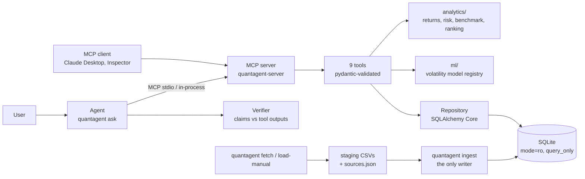

# QuantAgent

QuantAgent answers questions about Indian equity mutual funds from real public data. It downloads the
AMFI scheme list and full daily NAV histories (via mfapi.in) for every open-ended equity Direct-Growth
scheme with at least five years of history, AMFI expense-ratio disclosures, and optionally Nifty Total
Return Index and 91-day T-bill files. It validates them into a SQLite database and serves nine analytics
tools over the Model Context Protocol (MCP). An LLM agent answers through those tools, and every number
in its answer is checked against the tool output it cites. A walk-forward-evaluated model forecasts
21-day volatility. Read-only MCP server + agent + volatility model over real AMFI data.

[](https://github.com/Likhith1807/bluestock-quantagent/actions/workflows/ci.yml)


The coverage badge is regenerated by CI on every push to `master`; CI fails below 90%.

Built on work from my Bluestock internship. This repository contains no Bluestock data; the test
suite uses a synthetic fixture generated in `tests/fixtures/`.

## Architecture



## Quickstart

From a fresh clone to a first answer, in a clean Docker container:

```bash
git clone https://github.com/Likhith1807/bluestock-quantagent.git && cd bluestock-quantagent
docker build -t quantagent .
docker run --rm -v qa:/app/var quantagent setup --ter-months 1    # downloads AMFI data, ingests
docker run --rm -v qa:/app/var quantagent tool rank_funds '{"metric": "sharpe", "period": "3y", "category": "Large Cap", "top_n": 3}'
docker run --rm -v qa:/app/var -e ANTHROPIC_API_KEY quantagent ask "Which large-cap fund had the best 3-year Sharpe ratio?"
```

The fourth command answers without an LLM (one tool call, JSON out). The fifth needs an Anthropic API
key. Without Docker: `pip install -e ".[dev]"`, then the same commands without the `docker run` prefix.
`quantagent train` adds the volatility model (about 40 minutes on 308 schemes, mostly GARCH fits).
Checked on 2026-10-20 with an empty Docker volume: `setup --ter-months 1` took 5 min 15 s (308 schemes, 876,930 NAVs) and the `rank_funds` call returned the ranking shown in the worked example below. A fresh `git clone` builds the Docker `test` target (ruff, 218 tests, evaluation) without errors.

Nifty TRI and T-bill data must be downloaded by hand, because both sites block scripts. Put the files
in `data/external/` (see `quantagent load-manual --help`) and rerun `quantagent load-manual && quantagent ingest`.

## Tools

Full schemas and real outputs: [docs/TOOLS.md](docs/TOOLS.md). Every result carries `meta`
(period, n_obs, data_as_of, data_version, calc_version, data_nature, data_source, data_retrieved_at,
assumptions), `warnings` and `excluded`. Errors are `{code, message, details}`.

| Tool | Purpose | Key inputs | Key output fields |
|---|---|---|---|
| `search_funds` | Find schemes by name, code, category, fund house | `query`, `category`, `fund_house`, `plan_type` | `items[].scheme_code`, `latest_expense_ratio`, `nav_coverage`, `total_matches` |
| `get_nav_history` | NAV series with gap detection | `scheme_code`, dates, `frequency` | `points[]`, `gaps[]`, `missing_trading_days` |
| `get_risk_metrics` | One fund's risk over a window | `scheme_code`, `period` or dates | `volatility`, `sharpe`, `sortino`, `max_drawdown{}`, `alpha`, `beta`, `n_obs` |
| `compare_funds` | 2-10 funds on the same dates | `scheme_codes`, `period` | `funds[].cagr/volatility/sharpe`, `correlation`, `fair_comparison` |
| `rank_funds` | Screen a category by a metric or weighted score | `metric` or `weights`, `period`, `category` | `ranked[].metrics`, `eligible_count`, `excluded[]` |
| `get_benchmark_comparison` | Fund vs its Nifty TRI | `scheme_code`, `period` | `tracking_error`, `information_ratio`, `excess_cagr`, capture ratios |
| `check_data_quality` | Gaps, stale runs, jumps, metadata | `scheme_codes` | `schemes[].status`, `issues[]` |
| `get_data_provenance` | Sources, download dates, licences, biases | `scheme_code` (optional) | `sources[]`, `assumptions`, `known_biases` |
| `predict_volatility` | 21-day volatility forecast | `scheme_code`, `as_of` | `forecast_vol`, `baselines{}`, `model{}` (out-of-sample scores) |

## Worked example

Question: *"Which three large-cap funds had the best 3-year Sharpe ratio, and how deep was the leader's
worst drawdown?"* (data as of 2026-10-19).

Tool calls, run with `quantagent tool` (an agent makes the same calls; `quantagent ask` prints its own
call log):

```json
rank_funds {"metric": "sharpe", "period": "3y", "category": "Large Cap", "top_n": 3}
```
```json
{"period": "3y", "ranked_by": "sharpe", "universe_size": 27, "eligible_count": 27,
 "ranked": [
  {"rank": 1, "scheme_code": "118870", "scheme_name": "Taurus Large Cap Fund - Direct Plan - Growth",
   "metrics": {"sharpe": 0.5233, "cagr": 0.1304, "volatility": 0.1396, "max_drawdown": -0.1762}, "expense_ratio_pct": 2.51},
  {"rank": 2, "scheme_code": "120392", "scheme_name": "Invesco India Large Cap Fund - Direct Plan - Growth",
   "metrics": {"sharpe": 0.4918, "cagr": 0.1281, "volatility": 0.1448, "max_drawdown": -0.1821}, "expense_ratio_pct": 0.9},
  {"rank": 3, "scheme_code": "118479", "scheme_name": "BANDHAN LARGE CAP FUND - Direct Plan - Growth",
   "metrics": {"sharpe": 0.4473, "cagr": 0.1195, "volatility": 0.1355, "max_drawdown": -0.1795}, "expense_ratio_pct": 1.06}],
 "warnings": ["Survivorship bias: closed and merged schemes are absent from the source data, ..."]}
```
```json
get_risk_metrics {"scheme_code": "118870", "period": "3y"}
```
```json
{"volatility": 0.1396, "sharpe": 0.5233, "sortino": 0.7151, "alpha": null, "beta": null, "n_obs": 735,
 "max_drawdown": {"max_drawdown": -0.1762, "peak_date": "2024-09-27", "trough_date": "2025-02-28",
                  "recovery_date": "2026-07-31"},
 "risk_free_annual": 0.065, "risk_free_source": "Config default (assumption): approx. RBI 91-day T-bill yield, FY2024-25",
 "meta": {"period": {"start": "2023-10-19", "end": "2026-10-19"}, "data_nature": "real"}}
```

Answer, using only these outputs (values rounded; JSON above is shortened to 4 decimals):

> Over the three years to 2026-10-19, the highest Sharpe ratios among the 27 large-cap Direct-Growth
> funds were Taurus Large Cap (0.52, calculated), Invesco India Large Cap (0.49, calculated) and
> Bandhan Large Cap (0.45, calculated). Taurus's worst drawdown was -17.6% (calculated), from
> 2024-09-27 to 2025-02-28, recovered by 2026-07-31. The Sharpe ratios use a 6.5% risk-free rate
> (assumed: no T-bill series loaded). Alpha and beta are missing because no benchmark series was
> loaded. Taurus's 2.51% expense ratio is well above the other two. Survivorship bias applies. Not
> investment advice.

## Methodology

Summary; the full definitions are in [METHODOLOGY.md](src/quantagent/resources/METHODOLOGY.md), also served
as the MCP resource `quantagent://methodology`.

* Daily simple returns, 252-day annualisation. CAGR uses calendar days / 365.25. Sharpe and Sortino use
  daily excess returns over the risk-free rate.
* **Growth options only:** IDCW NAVs fall on every payout, so they are not total-return series.
* **Benchmarks are Total Return Indices** (Nifty TRI), assigned by SEBI category. PRI series, if loaded,
  trigger a warning.
* **Risk-free:** 91-day T-bill yields when loaded (forward-filled). Otherwise a configured constant,
  labelled as an assumption in every response.
* **Minimum history:** a 1y/3y/5y window needs NAVs on at least 90% of its trading days. Risk ratios need
  60 returns; alpha and beta need 120 shared returns. Short of that, the tool returns `INSUFFICIENT_HISTORY`.

## Evaluation results

35 questions, generated from the loaded database by fixed rules. Their expected answers are computed
independently with plain SQL and pandas (`src/quantagent/evaluation/expected.py`), and 12 of them are
edge cases: invalid codes and dates, an unknown benchmark, a misspelt argument, empty results and too
little history. Full report: [reports/eval_report.md](reports/eval_report.md).

| Mode | Answer accuracy | Numerical accuracy | Tool selection | Failure rate | Latency p50 / p95 |
|---|---|---|---|---|---|
| Direct analytics baseline (expected tool, fixed arguments), real data | 100% (35/35) | 100% (35 checks, rel. tol 1e-9) | 100% by construction | 0% | 10 ms / 242 ms |
| Agent (LLM chooses tools from the question text) | not run yet | not run yet | not run yet | not run yet | not run yet |

The agent column needs an Anthropic API key: `quantagent eval --agent`. It scores a number only when a
verified claim cites a tool output equal to the expected value. CI runs the direct mode on the synthetic
fixture on every push and fails below 100%.

Known failures: none in direct mode on the current data. The failures found while building the
evaluation, and their fixes, are listed in [docs/eval_fixes.md](docs/eval_fixes.md).

## Volatility model results

Forecast target: annualised realised volatility over the next 21 trading days. Walk-forward by calendar
year, 2014 to 2026: 13 folds, 153 test months, 308 schemes, 34,635 test rows. Training targets end at
least 30 days before each test year. QLIKE is on variance and MAE on volatility; lower is better. DM is
the Diebold-Mariano test against EWMA on monthly mean QLIKE (Newey-West, HLN). Full tables, including
all-rows results and every pairwise test: [reports/vol_model_report.md](reports/vol_model_report.md).

| Model | QLIKE | MAE | DM stat, HAR-RV vs this model | p-value |
|---|---|---|---|---|
| Naive (last 22-day RV) | 0.3935 | 0.0496 | -2.88 | 0.005 |
| EWMA (lambda 0.94) | 0.3376 | 0.0477 | -0.98 | 0.33 |
| GARCH(1,1) per scheme | 0.3079 | 0.0481 | 0.39 | 0.69 |
| **HAR-RV (log, pooled OLS), served** | **0.3114** | **0.0417** | - | - |
| Ridge (HAR + 6 features) | 0.3263 | 0.0421 | -1.45 | 0.15 |
| Gradient boosting (same features) | 0.3408 | 0.0425 | -1.97 | 0.05 |

A negative DM statistic means HAR-RV has the lower loss.

What this shows:
* **HAR-RV vs EWMA:** QLIKE is 7.8% lower, but the difference is not statistically significant
  (p = 0.33).
* **HAR-RV vs naive:** QLIKE is 20.9% lower, and that difference is significant.
* **HAR-RV vs GARCH:** a statistical tie. GARCH's mean QLIKE is 1.1% lower (p = 0.69), but HAR-RV
  has the lower median QLIKE and MAE.
* **ML models:** neither ridge nor gradient boosting beat HAR-RV, so the registry serves HAR-RV.
  PyTorch was not tried; see [DESIGN_DECISIONS.md](docs/DESIGN_DECISIONS.md).

These scores are on target windows without suspect NAVs. Fourteen test rows contain a daily move
above 15% or 5+ identical NAVs; including them raises EWMA's QLIKE to 0.873 and HAR-RV's to 0.467.

Reproducibility:
* Seeds are fixed (`Config.seed = 42`).
* Each trained model is a hash-checked registry version (`models/registry/`) with its config,
  features, data version and scores.
* Every run is appended to [reports/experiments.jsonl](reports/experiments.jsonl).
* Rerun with `quantagent train`.

## Limitations

* **Survivorship bias:** only schemes alive on the download date are included. Merged and closed schemes
  are missing, so category averages are biased upward.
* **Daily data only:** one NAV per day. There is no intraday data, so realised volatility is a noisy
  daily-return estimate.
* **Expense ratio timing:** TER history covers only the months downloaded. Older windows are shown with
  the latest known TER.
* **SEBI's 2018 category reshuffle:** a scheme's current category may not describe what it held before
  2018.
* **No transaction costs,** exit loads or taxes.
* **Benchmarks by category:** sectoral, thematic and focused funds are compared with a broad-market index.
* **Not investment advice.**

## Configuration and secrets

All settings are `QUANTAGENT_*` environment variables or a `.env` file; see [.env.example](.env.example).
Key settings: `QUANTAGENT_DB_URL`, `QUANTAGENT_RISK_FREE_ANNUAL`, `QUANTAGENT_MODEL_DIR` and the
`*_DIR` paths. The agent reads `ANTHROPIC_API_KEY` into a pydantic `SecretStr`, which prints as
`**********`. Nothing secret is ever logged:
* Server logs are JSON lines on stderr, carrying the tool name, sanitised arguments, duration and
  error code.
* Agent run files record the question, tool calls, outputs and verification, never keys or
  environment variables.
* `.env` is git-ignored.

## Development

```bash
pip install -e ".[dev]"
ruff check src scripts tests
pytest --cov=quantagent                  # unit, tool, protocol, agent, pipeline tests on synthetic data
pytest -m realdata                       # after fetch + ingest: tools vs independent pandas, rel. 1e-9
quantagent eval --fixture                # evaluation questions on the synthetic fixture (what CI runs)
docker build --target test .             # the same on Linux / Python 3.12
python scripts/gen_tools_doc.py          # regenerate docs/TOOLS.md from the live server
quantagent profile                       # regenerate docs/DATA_PROFILE.md from the database
```

Docs: [DATA_PROFILE.md](docs/DATA_PROFILE.md) (sources, download dates, coverage, licences),
[DESIGN_DECISIONS.md](docs/DESIGN_DECISIONS.md), [eval_report.md](reports/eval_report.md),
[vol_model_report.md](reports/vol_model_report.md).

## Licence

MIT for the code in this repository ([LICENSE](LICENSE)). Downloaded data stays under its publishers'
terms and is not committed.
